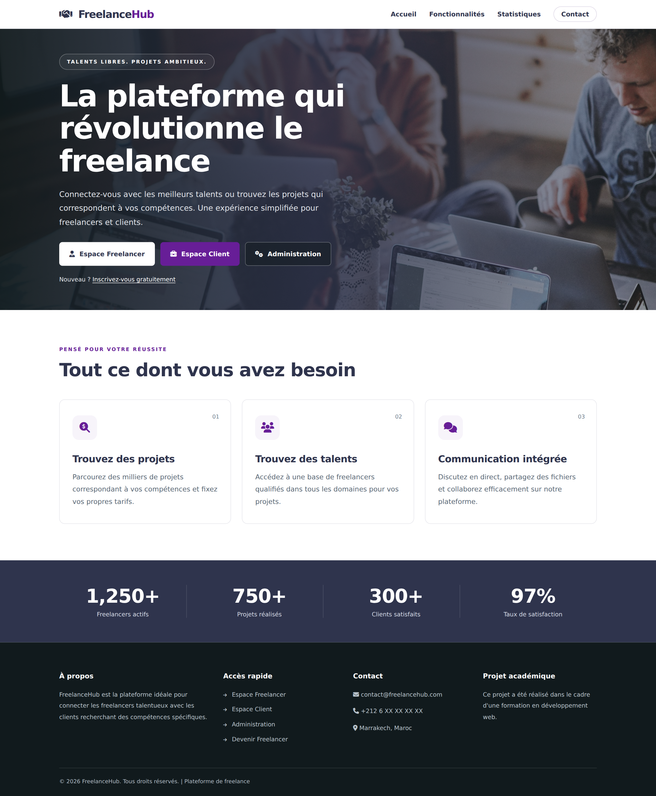

# 💼 FreelanceHub

### Plateforme web de mise en relation entre clients et freelancers

FreelanceHub est une application web développée en **PHP et MySQL**. Elle permet aux clients de publier leurs idées de projets et aux freelancers de proposer leurs services, négocier les offres et présenter leurs réalisations.

Le projet propose trois espaces : **Client**, **Freelancer** et **Administration**.

---

## 🖼️ Aperçu de la plateforme

![Page d’accueil FreelanceHub]

---

## 🎯 Objectifs

- Faciliter la mise en relation entre clients et freelancers.
- Centraliser les idées de projets et les propositions.
- Permettre la négociation des offres.
- Assurer le suivi des projets.
- Valoriser les réalisations des freelancers.
- Faciliter la gestion de la plateforme.

---

## 🚀 Fonctionnalités

### 👤 Espace Client

- Inscription, connexion et déconnexion.
- Accès au tableau de bord.
- Publication d’idées de projets.
- Consultation des idées publiées.
- Consultation des propositions reçues.
- Négociation des offres avec les freelancers.
- Acceptation des propositions.
- Suivi des projets.
- Consultation des projets réalisés.
- Dépôt et suivi des réclamations.

### 👨‍💻 Espace Freelancer

- Inscription, connexion et déconnexion.
- Accès au tableau de bord.
- Consultation des idées proposées par les clients.
- Envoi et suivi des propositions.
- Négociation des offres.
- Consultation des projets.
- Ajout et gestion des projets réalisés dans le portfolio.
- Dépôt et suivi des réclamations.

### 🛠️ Espace Administration

- Connexion à l’espace administrateur.
- Accès au tableau de bord.
- Gestion des clients et des freelancers.
- Gestion des idées et des projets.
- Gestion des projets réalisés.
- Consultation et traitement des réclamations.

---

## 🎨 Interface

- Page d’accueil avec photographie en arrière-plan.
- Palette de couleurs bleu-gris et violet.
- Navigation compacte.
- Accès direct aux trois espaces.
- Présentation des fonctionnalités sous forme de cartes.
- Mise en page adaptée aux ordinateurs, tablettes et mobiles.
- Icônes Font Awesome.

---

## 💻 Technologies utilisées

| Technologie | Utilisation |
|-------------|-------------|
| PHP | Logique serveur et traitement des données |
| PDO | Accès à la base de données |
| MySQL | Stockage des données |
| HTML5 | Structure des pages |
| CSS3 | Mise en forme et adaptation aux écrans |
| JavaScript | Interactions et animations |
| Font Awesome | Icônes |
| XAMPP | Environnement de développement local |
| phpMyAdmin | Administration de la base de données |

---

## 📂 Structure du projet

```text
freelance_hub/
├── admin/
│   ├── dashboard.php
│   ├── gestion.php
│   ├── gestion_reclamation.php
│   ├── login.php
│   ├── logout.php
│   └── reclamations.php
├── client/
│   ├── ajouter_idee.php
│   ├── dashboard.php
│   ├── deposer_reclamation.php
│   ├── login.php
│   ├── logout.php
│   ├── mes_idees.php
│   ├── mes_propositions.php
│   ├── mes_reclamations.php
│   ├── reclamation.php
│   ├── register.php
│   ├── suivi_projets.php
│   └── voir_projet_realiser.php
├── freelancer/
│   ├── dashboard.php
│   ├── deposer_reclamation.php
│   ├── idees.php
│   ├── login.php
│   ├── logout.php
│   ├── mes_propositions.php
│   ├── mes_reclamations.php
│   ├── postuler.php
│   ├── projet_realiser.php
│   ├── projets.php
│   ├── reclamation.php
│   └── register.php
├── css/
│   └── style.css
├── images/
│   └── accueil.png
├── config.php
├── index.php
└── README.md
```

> Le dossier `images` et le fichier `accueil.png` sont à ajouter pour afficher la capture d’écran dans ce README.

---

## ⚙️ Installation en local

### 1. Préparer l’environnement

Installer XAMPP, puis démarrer **Apache** et **MySQL**.

### 2. Ajouter le projet

Placer le dossier du projet dans :

```text
C:\xampp\htdocs\freelance_hub
```

### 3. Préparer la base de données

Ouvrir phpMyAdmin :

```text
http://localhost/phpmyadmin
```

Créer la base de données et importer le script SQL du projet.

> Le script SQL n’est pas inclus dans l’archive actuelle. Il doit être fourni séparément pour installer la base de données.

### 4. Configurer la connexion

Adapter les paramètres de connexion dans `config.php` :

- Hôte MySQL.
- Nom de la base de données.
- Nom d’utilisateur.
- Mot de passe.

### 5. Lancer l’application

Ouvrir l’adresse suivante dans un navigateur :

```text
http://localhost/freelance_hub/
```

Une connexion Internet est nécessaire pour charger la photographie d’accueil et les icônes depuis leurs services externes.

---

## 📚 Contexte du projet

Projet académique réalisé dans le cadre d’une formation en développement informatique.

Il met en pratique le développement d’une application web avec plusieurs rôles, la gestion de données avec PHP et MySQL et la création d’interfaces adaptées aux différents utilisateurs.

---

## 👩‍💻 Développé par

**Inass Silbi**

[Profil GitHub](https://github.com/inassdev99)